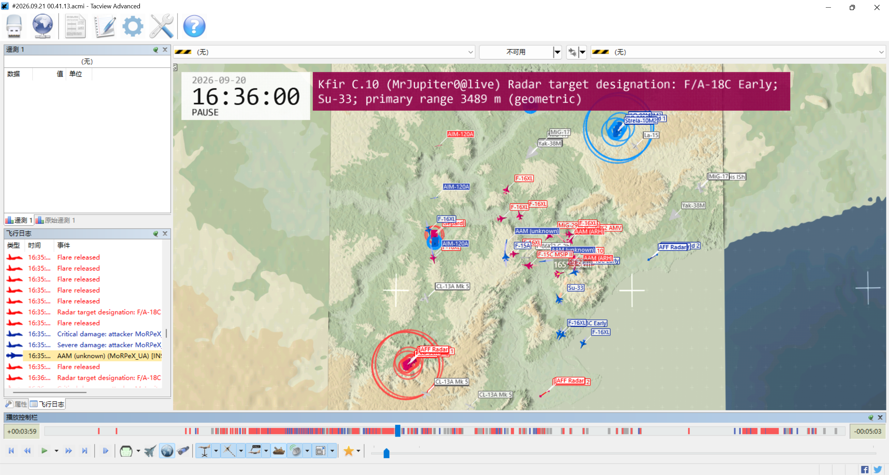
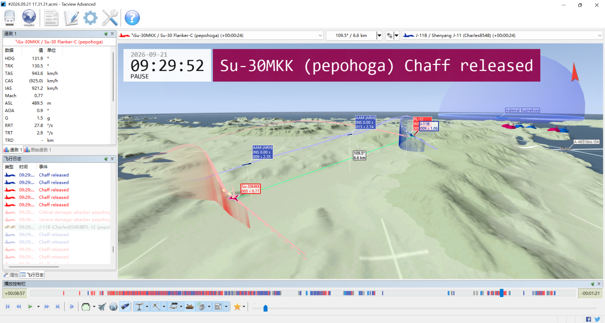

# WRPL-ACMI

[简体中文](README.zh-CN.md) | [English](README.md)

> A single-file `.exe` tool that converts War Thunder `.wrpl` replays into Tacview-compatible `.acmi` files

<p align="center">
  
  
</p>
[Export guide](docs/acmi-export.md) | **[Download releases](https://github.com/3794432/wrpl-acmi/releases)** | [Documentation](docs/README.md) | [Build and release](docs/standalone-build.md)

## Features and purpose

### Basic features

* Convert [War Thunder](https://warthunder.com/) air battle replays into a format that can be played in [Tacview](https://www.tacview.net/)
* Convert a single local `.wrpl` replay or a directory of server replay `.wrpl` shards into an `.acmi` file
* Convert replays by dragging a file or directory onto the `.exe`, or pass an input path using options such as `-in`

### Advanced features

* Enable or disable exports of countermeasures, radar targets, and other data
* Export track lists, missile flight parameters, and other `.csv` data files
* Estimate heading, speed, G-load, and other native `.acmi` data from aircraft positions and attitudes

The project is based on [wrpl-inspector v3](https://github.com/maxsupermanhd/wrpl-inspector), retaining its Go replay parser library and dear-imgui graphical inspector alongside a headless `cmd/acmi` exporter. Development takes place on the [dev branch](https://github.com/3794432/wrpl-acmi/tree/dev). The Go module path remains `github.com/maxsupermanhd/wrpl-inspector/v3`.

## Quick start

### Downloads

Download the executables from the [latest release](https://github.com/3794432/wrpl-acmi/releases/latest):

* [`wrpl-acmi.exe`](https://github.com/3794432/wrpl-acmi/releases/latest/download/wrpl-acmi.exe) converts replays to `.acmi` files (required)
* [`wrpl-terrain-installer.exe`](https://github.com/3794432/wrpl-acmi/releases/latest/download/wrpl-terrain-installer.exe) installs terrain for Tacview (optional)

### Convert `.wrpl` replays to `.acmi` files

The following example runs the converter in PowerShell:

```powershell
.\wrpl-acmi\wrpl-acmi.exe -in "C:\Replays\replay.wrpl" -out "C:\Replays\replay.acmi"
.\wrpl-acmi\wrpl-acmi.exe -in "C:\Replays\server-session" -out "C:\Replays\server-session.acmi"
```

You can run `wrpl-acmi.exe` on its own from another path. Its default lookup tables are compiled into the program. Converting a file does not require an adjacent directory, the local game, installed terrain, PowerShell, Python, Go, Git, or Tacview. Use Tacview to open the generated ACMI file.

For server replays, download them first, place the shards from the same match in one directory, and pass that directory as the input. The program sorts the shards by their headers and does not accept an individual server shard. See [server replay shard export](docs/ACMI_SERVER_REPLAYS.md) for details.

You can also convert a single client replay file or a server replay directory by dragging it onto `wrpl-acmi.exe`. Without `-out`, the program writes `<input filename>.acmi` in the current working directory. If a server replay is missing its final shard, it writes `<input directory name>.partial.acmi` and marks the replay as incomplete. The optional `run.bat` launcher changes to the package directory before running the program.

A single positional argument is also supported from the command line. All options must precede the input path, and `-in` cannot also be specified.

```powershell
.\wrpl-acmi.exe -out "C:\Replays\replay.acmi" "C:\Replays\replay.wrpl"
```

See the [export guide](docs/acmi-export.md) for complete options, output rules, and common issues.

### Install terrain for use in Tacview

Installing terrain is optional. Without the in-game terrain, the ACMI file still contains the exported replay objects, but Tacview's background terrain may not match the game map.

An installer containing terrain data can be run directly:

```powershell
.\wrpl-acmi\wrpl-terrain-installer.exe
```

The default installation location is `%APPDATA%\Tacview\Data\Terrain\Custom\WarThunderMaps`. The installer depends on Windows PowerShell. At the default resolution, reserve at least 8 GB of free space for the complete 69-map set; the installed data occupies about 4 GB. After installation, fully quit and restart Tacview, then re-export previously exported replays from their original `.wrpl` files to ensure that tracks and terrain use the same coordinate configuration.

Exports and installations use the geographic layout by default. Of the 69 maps, 14 use reviewed WGS84 estimates and 55 use Atlas fallback coordinates. Atlas coordinates are for technical display, not real-world placement. To select Atlas explicitly, pair the installer's `-atlas` option with the exporter's `-terrain-layout atlas`; `-alt` changes only the vertical offset.

Terrain heights come from the game's `levels/*.bin` files. Boundaries, water levels, and other configuration come from [War-Thunder-Datamine](https://github.com/gszabi99/War-Thunder-Datamine), and geographic latitude and longitude placement comes from the reference data in [WT-MAP-ANALYZE](https://github.com/ShioUmiusi/WT-MAP-ANALYZE).

## ACMI content and data types

An `.acmi` file converted from `.wrpl` replay data contains original replay records, estimates derived from those records, and static configuration data. Use each object's source fields to distinguish these three kinds of information. The default output is ACMI 2.1.

| Content | Data type |
| --- | --- |
| Aircraft and ground units | Positions come from the replay, and aircraft retain their attitude. Headings for moving ground units are inferred, and destroyed units are marked `Destroyed` before removal. Eligible static structures can use timestamped ECS construction positions. |
| Missiles and bombs | Actual positions are preferred where available, and missile motion parameters are calculated from positions. Bombs with only construction records show their release position and are marked `Release position only`. |
| Countermeasures | When reliable ammunition evidence distinguishes Flare and Chaff, the identified type is used; unresolved types are shown as Chaff. Countermeasure tracks are estimated. |
| Airfields and runways | Configured from the map, mission, and verifiable radar records. The catalogue covers 69 maps and 457 missions, with usable runway information for 67 maps. |
| Radar target designations | Writes Tacview's `LockedTarget` property and calculable distance and angle information. A designation may include tracking information but does not mean the radar is in tracking mode. |
| Air-defence reference ranges | Hard-coded references for 255 models. |
| Metadata and events | Includes titles, authors, timestamps, source notes, coalition groups, and replay event messages. Award and highlighted bookmarks are disabled by default; aircraft telemetry estimates are enabled by default. |

By default, `-events=kill,chat,join,damage,radar` outputs kills with clear attribution and weapon information, chat, player roster changes, Critical/Severe Damage, and radar target designation changes. Kills with missing or conflicting attribution are skipped, and an aircraft kill time must match its destruction time. Use `-events=none` to disable these events, or select a comma-separated subset. Award is disabled by default; add `award` or use `-events=all` to enable it. Highlighted bookmarks are disabled by default, retaining ordinary Chaff/Flare logs and avoiding duplicate highlighted rows; use `-bookmarks=true` when needed. See [event message details](docs/acmi-information.md#message-timeline).

CSV reports for track lists, missile flight parameters, countermeasure constructions, and radar designation changes are all optional outputs. Each report is generated only when its output path is supplied.

Aircraft speed, G-load, and related values are calculated under no-wind, standard-atmosphere conditions. IAS is an EAS approximation, and the three-axis G values estimate specific force. Static guidance types are independent of seeker operating state, and runway information cannot prove that the runway is active in the current game. See the documentation for details.

## Build from source

Building a Windows release package requires PowerShell and Go 1.25.6 or later. Fetch the source and run the build script in PowerShell:

```powershell
git clone --branch dev --single-branch https://github.com/3794432/wrpl-acmi.git
Set-Location .\wrpl-acmi
.\build.ps1
```

The default output directory is `dist\wrpl-acmi`, containing two independently usable programs:

* `wrpl-acmi.exe` converts replays; its default data is embedded.
* `wrpl-terrain-installer.exe` installs converted game terrain in Tacview. A normal build does not include terrain data, and installation requires an external terrain directory.

A complete converted terrain directory can be bundled into the installer:

```powershell
.\build.ps1 -TerrainSource ".\converted-terrain"
```

Extracting and converting terrain from the local game also requires 64-bit Python 3.12, Git, the converter dependencies, and a pinned [War-Thunder-Datamine](https://github.com/gszabi99/War-Thunder-Datamine) configuration. See the [terrain tool guide](tools/terrain/README.md#build-from-scratch) for environment setup and complete commands, and the [build and release guide](docs/standalone-build.md) for build options, resume support, and release artifacts. Historical releases may lag behind dev; build from that branch when you need the current implementation.

## Responsibility, related projects, and license

This project is still in early development. You are responsible for the consequences of running builds and release artifacts from this repository. The repository's [source-build workflow](.github/workflows/source-build.yml) configures exporter, parser-library, and synthetic terrain checks. Terrain conversion and its installer depend on game assets in the build environment. Loading and rendering in the Tacview GUI also require separate verification.

This project is based on [wrpl-inspector](https://github.com/maxsupermanhd/wrpl-inspector) v3, retaining its Go replay parser library and dear-imgui graphical inspector alongside a headless `cmd/acmi` exporter. The Go module path remains `github.com/maxsupermanhd/wrpl-inspector/v3`.

Some project content comes from [War-Thunder-Datamine](https://github.com/gszabi99/War-Thunder-Datamine) and [WT-MAP-ANALYZE](https://github.com/ShioUmiusi/WT-MAP-ANALYZE).

This project and the [wrpl-inspector](https://github.com/maxsupermanhd/wrpl-inspector) library are released under the [AGPL-3.0 license](LICENSE). Upstream copyright and license notices are retained. Maps and game assets are owned by [Gaijin Entertainment](https://gaijinent.com/).
